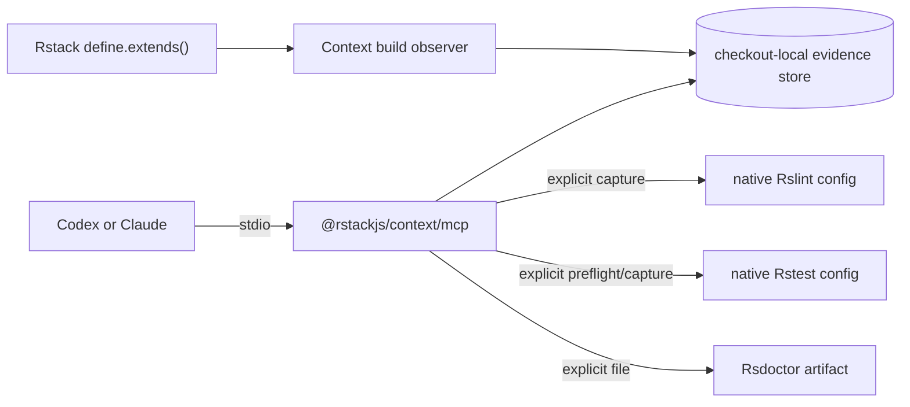

# Rstack Context ownership

## Status

Updated on 2026-10-22. Rstack shipped the shared-configuration API from
[RFC #504](https://github.com/rstackjs/rstack-cli/discussions/504) in 0.8.2. Context validates its
integration against Rstack 0.8.5 and stable Rslib 1.0.4.

## Decision

`rstackjs/context` owns the complete Context runtime:

- the evidence model and checkout-local store;
- Rsbuild and Rslib observers;
- native Rslint and Rstest capture;
- related-test discovery through Rstest's public reusable instance API;
- Rsdoctor artifact analysis;
- queries and diffs; and
- the programmatic stdio MCP server.

`rstackjs/agent-skills` owns installation manifests and agent workflows. Rstack CLI owns only its
general shared-configuration feature. It does not host Context, add `rs mcp`, generate lint/test
wrapper configs, or provide a Context plugin SPI.

## Runtime architecture

The stdio process is started by importing `runContextMcpServer()`. It is not a package binary or a
custom Rstack command.

## Shared-config integration

`@rstackjs/context/shared-config` returns ordinary shared configurations for `define.extends()`.
The factory checks its return value against Rstack's public `RstackConfig` type at build time.
Its published declarations keep the narrower Context type, so standalone consumers do not need
Rstack installed.

Rstack loads shared layers, merges App and Lib settings, and resolves test inheritance. Context
adds the build observer to the selected products. It does not implement a second config loader
or merge policy. Native CLI tests cover both products, nested layers, local overrides, disabled
capture, config provenance, and automatic test inheritance.

Rstack is a development dependency for these checks. MCP, native lint and test capture, Rsdoctor,
and store queries still run independently of the CLI.

## Native test boundary

Context uses `@rstest/core`'s public `loadConfig()` and reusable `createRstest()` API. It trusts
Rstest's native config discovery order and extensions. If discovery returns no config file,
`related_tests` and `test_snapshot` fail before constructing Rstest or writing a run manifest.

`related_tests` calls `listTests({ filesOnly: true, filters: sources, related: true })`.
`test_snapshot` runs the original source filters with `related: true`; it does not substitute the
preflight's test paths into execution.

## Compatibility

- Preserve the `@rstackjs/context` package name.
- Preserve `.rstack/cache/context-v1` reads and evidence semantics.
- Keep producer failures independent.
- Keep freshness, completeness, provenance, and evidence axes separate.
- Avoid runtime or peer dependencies on `rstack`.
- Do not preserve the abandoned CLI host APIs as compatibility shims.

## Verification

The repository must pass:

- frozen install;
- Rslint type-aware checks and formatting;
- Rslib build and declaration generation;
- the full Rstest suite, including native `rs build`, `rs lib build`, and `rs test run` fixtures;
- real stdio MCP initialization;
- native Rstest related preflight and execution;
- missing-config rejection before `createRstest`;
- packed-package import from a clean consumer; and
- pkg.pr.new preview publication.
