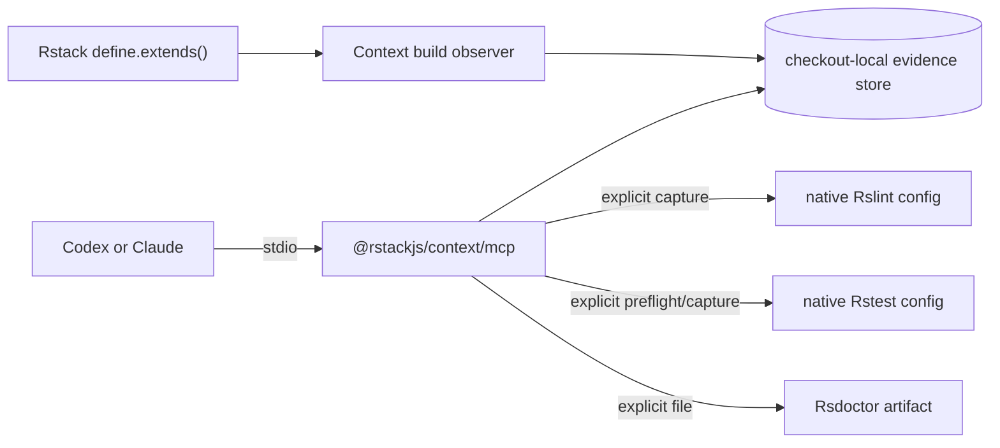

# Rstack Context ownership

## Status

Revised on 2026-09-23 after
[Rstack RFC #504](https://github.com/rstackjs/rstack-cli/discussions/504) replaced the proposed
Context-specific CLI plugin system.

## Decision

`rstackjs/context` owns the complete Context runtime:

- the evidence model and checkout-local store;
- Rsbuild and Rslib observers;
- native Rslint and Rstest capture;
- related-test discovery through Rstest's public reusable instance API;
- Rsdoctor artifact analysis;
- queries and diffs; and
- the programmatic stdio MCP server.

`rstackjs/agent-skills` owns installation manifests and agent workflows. Rstack CLI owns only its
general shared-configuration feature. It does not host Context, add `rs mcp`, generate lint/test
wrapper configs, or provide a Context plugin SPI.

## Runtime architecture

The stdio process is started by importing `runContextMcpServer()`. It is not a package binary or a
custom Rstack command.

## Shared-config gate

Passive build integration uses `@rstackjs/context/shared-config`, but it remains release-gated until
Rstack publishes the complete RFC #504 contract:

- public `RstackConfig`;
- public `define.extends()`;
- shared-layer loading;
- App and Lib native merges; and
- merged Test configuration before automatic App-versus-Lib inheritance.

The package can still ship and run its MCP, lint, test, Rsdoctor, store, and query features without
that Rstack release. Documentation must not present passive build setup as currently available until
the gate is satisfied.

## Native test boundary

Context uses `@rstest/core`'s public `loadConfig()` and reusable `createRstest()` API. It trusts
Rstest's native config discovery order and extensions. If discovery returns no config file,
`related_tests` and `test_snapshot` fail before constructing Rstest or writing a run manifest.

`related_tests` calls `listTests({ filesOnly: true, filters: sources, related: true })`.
`test_snapshot` runs the original source filters with `related: true`; it does not substitute the
preflight's test paths into execution.

## Compatibility

- Preserve the `@rstackjs/context` package name.
- Preserve `.rstack/cache/context-v1` reads and evidence semantics.
- Keep producer failures independent.
- Keep freshness, completeness, provenance, and evidence axes separate.
- Avoid runtime or peer dependencies on `rstack`.
- Do not preserve the abandoned CLI host APIs as compatibility shims.

## Verification

The repository must pass:

- frozen install;
- Rslint type-aware checks and formatting;
- Rslib build and declaration generation;
- the full Rstest suite;
- real stdio MCP initialization;
- native Rstest related preflight and execution;
- missing-config rejection before `createRstest`;
- packed-package import from a clean consumer; and
- pkg.pr.new preview publication.
